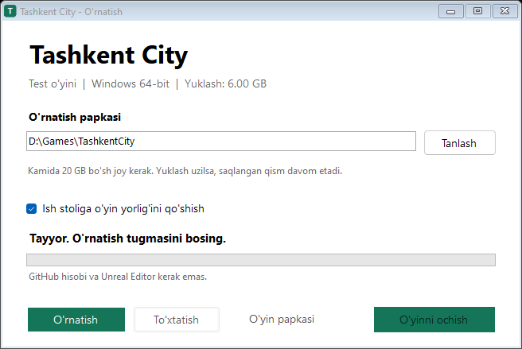

# Tashkent City ? Windows test o?yini

Tashkent City, AUT universiteti, park va Humo Arena atrofida haydash, erkin yurish va jang uchun **alpha test versiyasi**. O?zbekcha, English va Russian tillari mavjud.

## O?yinni yuklash

### [Install.TashkentCity.exe ? yangi versiyani yuklash](https://github.com/Shahzod1602/Tashkentcity-gtastyle/releases/download/alpha-20261012-city-feedback/Install.TashkentCity.exe)

**Versiya: alpha-20261012-city-feedback ? 2026-10-12**

1. Yuqoridagi **bitta faylni** yuklab oching.
2. O?yin uchun papka tanlang va **O?rnatish** tugmasini bosing.
3. Tugagach **O?yinni ochish** tugmasini bosing.
4. Asosiy menyuda **Tashkent City / Lyra** ni tanlang.

Installer **6.00 GB** paketni yuklaydi, tekshiradi va avtomatik chiqaradi. Internet uzilsa o?sha papkani tanlab davom ettiring. Windows x64, internet va o?rnatish davomida kamida **20 GB bo?sh joy** kerak. O?rnatilgan fayllar **6.58 GB**. GitHub hisobi, Unreal Editor va 7-Zip talab qilinmaydi. Installer raqamli imzo bilan imzolanmagan.

`VCRUNTIME` yoki `MSVCP` yetishmasa, o?yin papkasidagi **Install Runtime.cmd** ni oching. Avval **Muvozanatli / Balanced** grafikadan boshlang.

Oldingi o?rnatish o?z papkasida qoladi. Progress va sozlamalar `%LOCALAPPDATA%\TashkentCityTest` ichida saqlanadi. Lyra shahar rejimi eski rejimlardan alohida profil ishlatadi. Yangi installer yaratgan yorliq yoki o?yin papkasini oching.

## Bu versiyadagi yangiliklar

- 17 mashina modeli bo?yicha material va shikastlanish tekshiruvlari: oynalar, shinalar, kuzov zarbasi, ishdan chiqqan mashina va ta?mirlash holatlari.
- Xavfsiz mashinadan tushish, haydovchini chiqarib mashinaga o?tirish va haydovchi ko?rinishini saqlash; piyodalarning zarba/qochish reaksiyalari.
- Piyodalar o?tish joyi signallari, shikastlanadigan ko?cha chiroqlari, AUT yaqinidagi tekshirilgan yo?l va zinapoyalar.
- Uchta burchakli parking joyi, ikkita shlagbaum, yo?lak asfalti va yoritish; Hilton aylanma eshigi va daraxt panjaralari.
- Suzish, suvga tushgan mashina dvigatelining o?chishi, xavfsiz chiqish va tiklash/ta?mirlash.

**32 ta so?rovdan 19 tasi tekshirildi, 4 tasi qisman bajarildi, 9 tasiga aniq joy kerak.** [Batafsil reliz izohi](https://github.com/Shahzod1602/Tashkentcity-gtastyle/releases/tag/alpha-20261012-city-feedback).

**Lyra boshqaruvi:** WASD ? yurish/haydash; E ? mashinaga kirish/chiqish; Space ? sakrash/qo?l tormozi; G ? garaj; M ? xarita; Esc ? menyu. Piyoda H ? qurolni olish/yig?ishtirish; 1/2/3 ? pistolet/avtomat/shotgun; o?ng sichqoncha ? nishon; chap sichqoncha ? otish; R ? qayta o?qlash. Mashinada C ? kamera; B ? radio; N ? keyingi trek; L ? faralar. **Esc ? Jang** ichidan qidiruvsiz holatda bepul o?q va bronya olish mumkin.

## Sinov va cheklovlar

Yakuniy o?yin faylida Player, AUT, Environment va Water sinovlari o?tdi; 7 ta yakuniy o?yin rasmi ko?rib chiqildi. Toza paket menyusi tekshirildi. ZIP?dagi **198 ta fayl** to?liq o?qildi: CRC, hajmlar va manifestdagi 197 ta faylning SHA-256 qiymatlari mos. Installer ishlatadigan .NET ZIP o?quvchisi ham 198 ta faylni SHA-256 bo?yicha tekshirdi.

Installerning **23 ta tekshiruvi** kichik test paketlarida o?tdi: yuklashni davom ettirish, uzilish, buzilgan fayl, xavfsiz chiqarish va interfeys. Disk joyi cheklanganligi sabab ushbu 6 GB o?yinni installer orqali alohida papkaga qayta to?liq o?rnatish sinovi bajarilmadi. Shaxsiy save?lar, developer loglari, debug fayllari va Unreal loyihasining manba kodi paketga qo?shilmagan.

RTX 3050 Laptop 4 GB, Ryzen 5 6600H, 16 GB RAM; 1280?720 Balanced DX11; bir xil 180 soniyalik kunduz/tun/salon marshruti:

| Ko?rsatkich | Avval | Yangi |
|---|---:|---:|
| O?rtacha FPS, 1-solishtirish | 48.03 | 43.10 |
| p95, 1-solishtirish | 30.09 ms | 30.82 ms |
| p99, 1-solishtirish | 35.42 ms | 35.21 ms |
| 33 ms dan uzun kadrlar, 1-solishtirish | 171 | 161 |
| O?rtacha FPS, takroriy solishtirish | 47.46 | 44.43 |
| p95, takroriy solishtirish | 29.49 ms | 30.08 ms |
| p99, takroriy solishtirish | 34.68 ms | 34.24 ms |
| 33 ms dan uzun kadrlar, takroriy solishtirish | 141 | 129 |

**O?rtacha FPS 6?10% pasaydi; bu reliz FPS yaxshilanishi deb taqdim etilmaydi. 16.7 ms p95 maqsadi bajarilmagan.** Odam/transport limitlari kamaytirilmagan. Bu o?lchovlar boshqa PC uchun kafolat emas. RTX 5080, toza PC?da runtime o?rnatish va to?liq poyga aylanasi qayta tekshirilmagan.

Bu tugallanmagan alpha. Suzish animatsiyasi, tungi suv osti ko?rinishi, suv qirg?oqlari va barcha o?rindiqlar yonidagi chiqindi qutilari hali to?liq emas. Balanced?da Malibu/Spark 2011 kuzovida oldindan mavjud vizual nuqsonlar bor. Shahar to?liq 1:1 rekonstruksiya emas; ayrim fasad va materiallar oddiy, barcha interyerlar ochiq emas.

## Feedback

[Issues](https://github.com/Shahzod1602/Tashkentcity-gtastyle/issues) bo?limiga PC tarkibi, grafik sozlamalari, **aniq xarita joyi**, mashina/personaj, takrorlash qadamlari va rasm yoki qisqa video yozing. `FEEDBACK_TEMPLATE.txt` paket ichida bor. Fikrlar va loglar avtomatik yuborilmaydi.

## Qo?lda yuklash

[Release sahifasidan](https://github.com/Shahzod1602/Tashkentcity-gtastyle/releases/tag/alpha-20261012-city-feedback) **to?rtta** raqamlangan ZIP qismi (`.001`?`.004`), **Join.Test.ZIP.cmd**, **Join-Test-ZIP.ps1** va **TEST_PARTS.json** ni bitta papkaga yuklang. Join.Test.ZIP.cmd ni oching, yig?ilgan ZIP ni to?liq chiqaring va **Play Tashkent City.cmd** ni oching. GitHub?ning avtomatik `Source code` arxivlari o?yin paketi emas.

Asset manbalari va mavjud litsenziya qaydlari `SourceNotices` ichida. Bu repository uchinchi tomon assetlariga yangi litsenziya bermaydi.

## English quick start

[Download Install.TashkentCity.exe](https://github.com/Shahzod1602/Tashkentcity-gtastyle/releases/download/alpha-20261012-city-feedback/Install.TashkentCity.exe), choose a folder and click **O?rnatish** (Install). Then click **O?yinni ochish** (Open game) and select **Tashkent City / Lyra**. Interrupted downloads resume in the same folder. Download **6.00 GB**, installed files **6.58 GB**; allow **20 GB** free during installation. Windows x64 is required; Unreal Editor and a GitHub account are not required.

This alpha adds vehicle damage/material work, safer car entry/exit, civilian reactions, tested city access/lighting improvements and water recovery. Existing saves remain under `%LOCALAPPDATA%\TashkentCityTest`. 19 requests are verified, 4 partial and 9 need exact locations. Mean FPS decreased in two matched laptop comparisons. The archive was fully hash-checked with Python and .NET; installer fault tests used small fixtures, with no fresh full-game installation this time. Please read the limitations above and report reproducible issues with exact locations.
